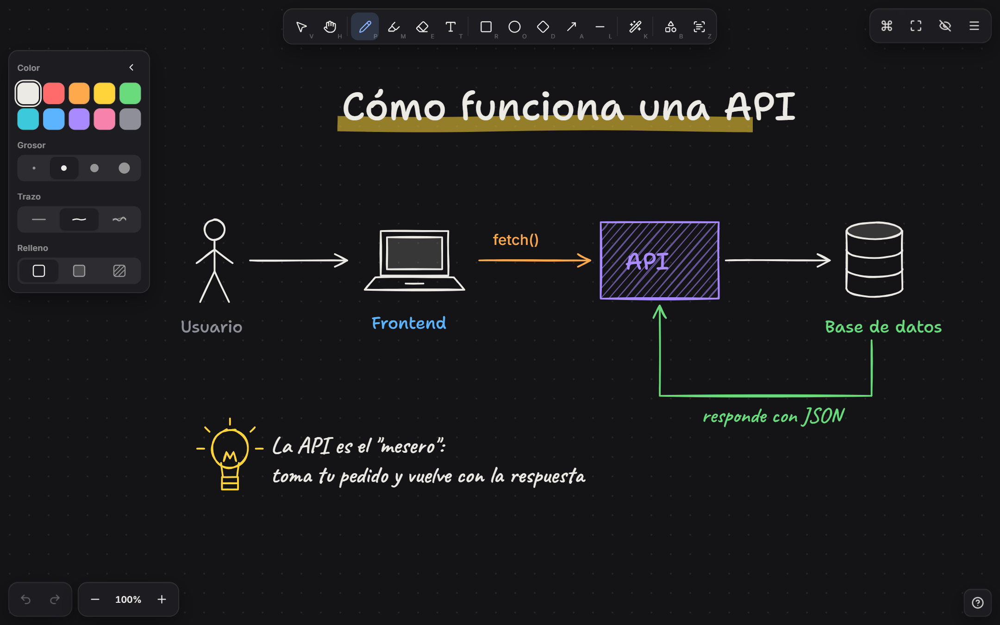
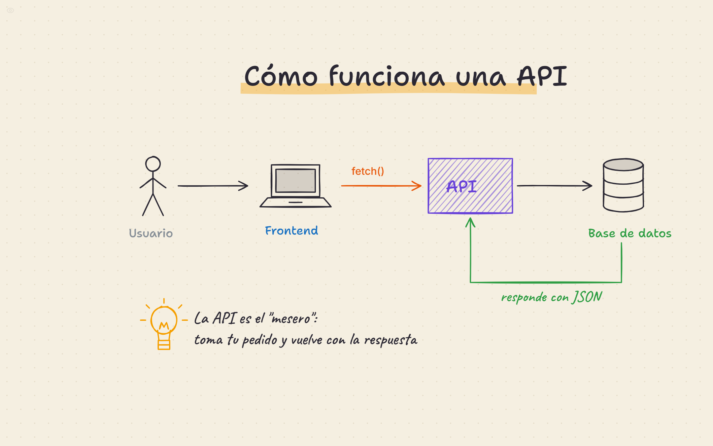

# Pizarra

Pizarra táctil hecha para **grabar videos que se vean profesionales**: la letra con el dedo sale pareja, las formas se arreglan solas y tienes una biblioteca de dibujitos a mano (personas, servidores, árboles, gráficos…) que aparecen trazándose.



**Úsala en:** https://ribs-org.github.io/pizarra/

---

## Qué arregla

| Problema con Whiteboard | Cómo lo resuelve Pizarra |
| --- | --- |
| La letra con el dedo parece de niño | **Estabilizador** que ignora el temblor del dedo + tinta con grosor variable. Y la **Lupa de escritura** (`Z`): escribes grande en un panel abajo, sobre un renglón, y en la pizarra queda chico y ordenado. Avanza sola cuando llegas al margen. |
| Círculos, cajas y flechas chuecas | Dibuja la forma y **deja el dedo quieto medio segundo**: se convierte en círculo, rectángulo, rombo, triángulo, línea, flecha o línea en codo, con estilo "a mano" limpio. Después de enderezar una línea puedes seguir moviendo el dedo para ajustar la punta. |
| Escribir títulos y textos | `Enter` abre un texto donde está el cursor (o bajo el último texto). 5 letras manuscritas: Marcador, Cuaderno, Imprenta, Plumón y Limpia. |
| Escribir sin que se vea el tecleo | `Ctrl+K`, escribe el texto y `Shift+Enter`: aparece **escribiéndose solo**, sin typos en cámara. |
| Dibujar personitas, arbolitos, diagramas | **Biblioteca** (`B`) con ~60 dibujos en 6 categorías. Toca para insertar o arrastra a la pizarra. Aparecen animados, como si alguien los dibujara. |
| Colores feos en video | Paletas pensadas para cámara en 5 fondos: Grafito, Noche, Pizarrón, Blanco y Papel. Los colores se adaptan al fondo. |
| La interfaz ensucia la grabación | **Modo grabación** (`.`) esconde todo, y **pantalla completa** (`F`). Puntero **láser** (`K`) que se desvanece, para señalar sin rayar. |



## Gestos táctiles

| Gesto | Acción |
| --- | --- |
| 1 dedo | Dibuja / usa la herramienta activa |
| 2 dedos | Mover la vista y hacer zoom (pellizco) |
| Toque con 2 dedos | Deshacer |
| Toque con 3 dedos | Rehacer |
| Mantener quieto al final del trazo | Convertir en forma limpia |
| Doble toque (herramienta Seleccionar) | Editar un texto / texto nuevo |
| Lupa: 2 dedos | Mover la zona de escritura |

## Atajos de teclado

| Tecla | Acción |
| --- | --- |
| `V` `H` `P` `M` `E` `T` | Seleccionar, mano, lápiz, destacador, borrador, texto |
| `R` `O` `D` `A` `L` | Rectángulo, elipse, rombo, flecha, línea |
| `K` | Puntero láser |
| `1` … `0` | Colores |
| `[` `]` | Grosor más delgado / más grueso |
| `Enter` | Escribir texto |
| `Ctrl+K` o `/` | Paleta de comandos (todo está ahí) |
| `Z` | Lupa de escritura (`Shift+Enter` = nueva línea) |
| `B` | Biblioteca de dibujos |
| `.` | Ocultar / mostrar interfaz |
| `F` | Pantalla completa |
| `Espacio` + arrastrar | Mover la vista |
| `Ctrl+Z` / `Ctrl+Y` | Deshacer / rehacer |
| `Ctrl+D` · `Supr` | Duplicar · eliminar selección |
| `Ctrl` + clic / arrastrar | Seleccionar varias cosas (con cualquier herramienta) |
| `Shift+1` · `Ctrl+0` | Ver todo · zoom 100% |
| `Ctrl+Shift+E` · `Ctrl+Shift+C` | Exportar PNG · copiar como imagen |
| `Ctrl+S` · `Ctrl+O` | Guardar · abrir archivo `.pizarra.json` |

`?` muestra todo esto dentro de la app.

## Flujo recomendado para grabar

1. Abre la pizarra en Edge o Chrome y **instálala como app** (menú `…` → *Aplicaciones* → *Instalar este sitio como aplicación*). Se abre en su propia ventana, sin barras del navegador.
2. Elige fondo (menú ☰). Grafito o Noche se ven muy bien en video; Papel para un estilo más "cuaderno".
3. `F` para pantalla completa y `.` para esconder la interfaz. El botón para volver a mostrarla es casi invisible (arriba a la izquierda).
4. Para escribir a mano usa la **Lupa** (`Z`). Si todavía tiembla, sube el **Suavizado** en el menú.
5. Prepara el contenido antes: lo dibujado se guarda solo en el navegador, y puedes guardar/abrir archivos para cada video.

## Desarrollo

```bash
npm install
npm run dev      # http://localhost:5173
npm test         # pruebas del reconocedor de formas
npm run build    # genera dist/
```

Cada push a `main` se publica solo en GitHub Pages (ver `.github/workflows/deploy.yml`).

**Stack:** React 19 + TypeScript + Vite, estado con Zustand, todo dibujado en SVG.

- `src/ink.ts`: estabilizador del trazo y "mantener para formas"
- `src/recognize.ts`: reconocedor de formas (con tests en `recognize.test.ts`)
- `src/controller.ts`: dedo, lápiz, mouse y gestos (pellizco, toques con 2 y 3 dedos)
- `src/stamps.ts`: la biblioteca de dibujos. Agregar uno nuevo es sumar una entrada con primitivas simples.
- `src/components/ZoomPad.tsx`: la lupa de escritura

## Créditos

- [perfect-freehand](https://github.com/steveruizok/perfect-freehand): tinta a mano alzada (MIT)
- [Rough.js](https://roughjs.com/): estilo dibujado a mano (MIT)
- Fuentes de Google Fonts vía Fontsource (OFL): Shantell Sans, Caveat, Patrick Hand, Kalam e Inter
- Íconos: [Lucide](https://lucide.dev/) (ISC)
